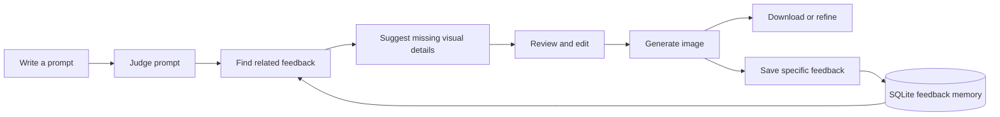

<div align="center">

# PromptPixel

### Turn a simple idea into an image prompt you can understand, edit, and refine.

PromptPixel is a text-to-image workspace that makes prompt improvement visible and keeps the creator in control. Review the original and suggested prompts side by side, see why details were added, then generate and refine an image without starting over.

<p>
  
  
  
</p>

</div>

---

## Screenshots

Add your screenshots to `docs/screenshots/` using the filenames below. The boxes are placeholders until you add the images.

<table>
  <tr>
    <td align="center" width="50%">
      <strong>Prompt workspace</strong><br>
      <sub>
</sub>
    </td>
    <td align="center" width="50%">
      <strong>Prompt review and improvements</strong><br>
      <sub>
</sub>
    </td>
  </tr>
  <tr>
    <td align="center" width="50%">
      <strong>Generated image</strong><br>
      <sub>
</sub>
    </td>
    <td align="center" width="50%">
      <strong>Saved feedback</strong><br>
      <sub>
</sub>
    </td>
  </tr>
</table>


## What it does

- **Reviews prompts:** scores and classifies a prompt, with Groq-assisted judging when configured and a local rule-based fallback.
- **Makes prompt changes visible:** checks for style, composition, lighting, mood/color, and detail, then explains suggested additions.
- **Keeps the original intent:** preserves the user's prompt and makes the enhanced version editable before image generation.
- **Learns from specific feedback:** stores notes about unsatisfactory results and can retrieve similar past prompts for a later attempt.
- **Generates and refines:** displays the generated image, supports downloading it, and lets the user return to refine the prompt.

## How it works



Prompt judging can use Groq, with a built-in local fallback. Feedback retrieval and the visual-slot optimizer run locally. Image generation uses Hugging Face Inference when configured; if that provider fails and a Pollinations key is configured, PromptPixel can fall back to Pollinations.ai.

## Prompt optimization

PromptPixel uses a deterministic, rule-based visual-slot optimizer. It checks the original prompt for five dimensions:

| Dimension | Example of what it helps specify |
|---|---|
| Style | A consistent visual treatment |
| Composition | Framing, viewpoint, and subject placement |
| Lighting | Light direction and atmosphere |
| Mood and color | Palette and emotional tone |
| Detail | Texture and clarity |

Only dimensions not detected by the rules are suggested. Each suggestion includes a short explanation, and the original prompt remains intact and editable.

The project's design contribution is this **intent-preserving, explainable, feedback-aware workflow**: prompt suggestions are inspectable, the user decides what to keep, and later iterations can build on specific feedback. These are transparent heuristics—not a newly trained model or a claim of experimentally proven image-quality gains.

## Tech stack

| Area | Technologies |
|---|---|
| Frontend | React 19, Vite 8, Tailwind CSS 4 |
| API | Node.js, Express 5 |
| Storage | SQLite with `better-sqlite3` |
| Prompt judge | Groq API (optional), local rule-based fallback |
| Feedback search | Local 128-dimensional hashed-token vectors and cosine similarity |
| Image generation | Hugging Face Inference and Pollinations.ai |

## Run locally

### Requirements

- Node.js **20.19+** or **22.12+**
- npm
- An image provider account/key for reliable image generation. Provider access and usage limits vary.
- A Groq API key is optional; the prompt judge has a local fallback.

### 1. Get the code and install dependencies

```bash
git clone https://github.com/<your-username>/<your-repository>.git
cd <your-repository>
npm --prefix backend ci
npm --prefix frontend ci
```

Replace the clone URL and repository directory with your GitHub repository details.

### 2. Configure the backend

In PowerShell:

```powershell
Copy-Item .\backend\.env.example .\backend\.env
```

Edit `backend/.env` and add whichever keys you have:

```env
# Optional: prompt judging; local fallback is used if unset
GROQ_API_KEY=your_groq_api_key

# Optional: primary image provider
HUGGINGFACE_API_KEY=your_huggingface_token

# Optional: Pollinations image provider / fallback
POLLINATIONS_API_KEY=your_pollinations_api_key

# Optional: defaults to 5000
PORT=5000
```

Keep `.env` private. Never commit API keys. Image providers may require account access or credits; PromptPixel cannot guarantee free or uninterrupted generation.

### 3. Start the backend and frontend

Open two terminals in the repository folder.

**Terminal 1 — backend**

```bash
npm --prefix backend start
```

**Terminal 2 — frontend**

```bash
npm --prefix frontend run dev
```

Open [http://localhost:5173](http://localhost:5173). The Vite development server proxies `/api` requests to the backend at `http://localhost:5000`.

The SQLite database and feedback index are created locally as needed. They are intentionally excluded from Git.

## API overview

All API routes use the `/api` prefix.

| Method | Route | Purpose |
|---|---|---|
| `GET` | `/api/health` | Check that the backend is running |
| `POST` | `/api/judge` | Score, classify, and review a prompt |
| `POST` | `/api/search-failures` | Find similar saved feedback |
| `POST` | `/api/enhance` | Add and explain missing visual details |
| `POST` | `/api/generate` | Generate an image |
| `POST` | `/api/log-failure` | Save a user's feedback |
| `GET` | `/api/failures` | List saved feedback |

## Project structure

```text
.
├── backend/
│   ├── routes/api.js
│   ├── promptOptimizer.js
│   ├── database.js
│   ├── faissIndex.js
│   ├── test/
│   └── .env.example
├── docs/
│   └── screenshots/
└── frontend/
    ├── public/
    └── src/
        ├── components/
        └── pages/
            ├── Home.jsx
            ├── Enhancement.jsx
            ├── Result.jsx
            └── Memory.jsx
```

## Tests and build

Run the backend tests:

```bash
npm --prefix backend test
```

Build the frontend for production:

```bash
npm --prefix frontend run build
```

## Notes and limitations

- Prompt scoring and visual-dimension detection are heuristic; a score is guidance, not an objective measure of image quality.
- Image generation requires an available provider and may be subject to provider outages, account permissions, rate limits, or credits.
- When Groq is configured, prompt text is sent to Groq for judging; image prompts are sent to the selected image provider. Saved feedback and prompt metadata are stored in the local SQLite database.
- This project is a prototype. Add authentication, rate limiting, deployment configuration, and production security controls before exposing the API publicly.

## Contributing

Issues and pull requests are welcome. For a change, open an issue or describe the problem, create a focused branch, and include relevant test or build results with your pull request.

## License

No repository-wide license file is currently included. Add a `LICENSE` file before granting reuse or redistribution rights.
